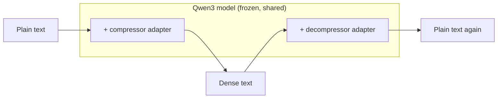

# heet: high-entropy English translator

heet teaches a small AI language model to write **dense English**: text that is much shorter than normal English but that a careful reader (or the model itself) can still expand back into the original.

Think of note-taking shorthand, or an old telegram where every word cost money:

| | Text | Length |
|---|---|---|
| **Original** | On its day of release in Japan, Valkyria Chronicles III topped both platform-exclusive and multi-platform sales charts. By early February, the game sold 102,779 units, coming in second overall to The Last Story for the Wii. By the end of the year, the game had sold just over 152,500 units. | 290 chars |
| **Dense** | Valkyria Chronicles III topped Japan sales charts on release day; sold 102,779 units by Feb; 152,500+ by year-end, 2nd to The Last Story (Wii). | 143 chars (49%) |
| **Expanded back** | Valkyria Chronicles III topped the Japan sales charts on its release day, selling 102,779 units by February and 152,500 plus by the end of the year, second to The Last Story (Wii). | |

The expanded text isn't word-for-word the original, but it keeps the meaning, the names and the numbers. That's the goal.

## Why?

It's a research experiment. Ordinary English carries a lot of predictable filler ("the", "was", "had been"). The questions are:

- How much of that filler can be removed while the meaning stays recoverable?
- Can a small model learn to do the squeezing *and* the un-squeezing?
- Does the dense text stay readable to a person, rather than turning into an unreadable code?

"High entropy" is the information-theory way of saying "every character carries more information".

## How it works, in plain terms

### The two jobs

The system has two halves that work like a **zip / unzip** pair for language:

- **Compressor**: plain English → dense English.
- **Decompressor**: dense English → plain English.

Running text through both is a *round trip*. If the result means the same as what went in, both halves did their job.

### One brain, two skill packs

Both halves use the same small language model, [Qwen3-0.6B](https://huggingface.co/Qwen/Qwen3-0.6B) (a free, open model small enough to run on a home gaming GPU). The model itself is **never changed**: its original knowledge of English stays frozen.

Instead, each job gets a small add-on called a **LoRA adapter**. An adapter is like a clip-on lens for a camera: the camera stays the same, and the lens changes what it does. Each adapter is about 40 MB, compared with about 1.2 GB for the model, and swapping one in takes milliseconds.



Under the hood, an adapter adds a small, trainable correction to every major internal layer of the model. Only those corrections are trained, which is why training fits on a single consumer graphics card.

### Where the training examples come from

A model learns by example, so the examples have to come from somewhere. heet borrows a bigger, smarter model (the **teacher**, `qwen3:14b`, run locally with [Ollama](https://ollama.com)) to make them:

1. **Collect text.** Take short passages (1–3 sentences) from Wikipedia articles.
2. **Teacher compresses.** Ask the teacher to rewrite each passage as dense English: abbreviate, drop little words, use symbols like `&`, `w/`, `→`, `~`, and keep every name and number exactly.
3. **Teacher expands, blind.** In a separate request, the teacher expands the dense text again *without seeing the original*.
4. **Quality check.** An example is kept only if:
   - the expansion means the same as the original (checked automatically by a meaning-comparison model),
   - the dense version is 30–80% of the original's length,
   - every number survived,
   - and the dense text isn't just a lightly edited copy.

   About 4 in 5 passages pass. The rest are logged with the reason they failed.

### Teaching the small model

The small model then studies the teacher's surviving examples, one adapter at a time:

1. **Decompressor first.** It learns to turn the teacher's dense text back into the original.
2. **Compressor second.** It learns to produce dense text like the teacher's. While it trains, heet keeps running round trips through the finished decompressor, so you can watch whether its dense text can actually be expanded back.

### Scoring the results

Each round trip gets a score made from three questions:

| Question | How it's measured | Target |
|---|---|---|
| Is the meaning preserved? | A separate meaning-comparison model rates how similar the original and the round-trip result are (0–1). | ≥ 0.90 |
| Is it actually shorter? | Dense length ÷ original length. | ≤ 0.55 |
| Is it still readable? | The plain model, with no adapters, judges how "surprising" the dense text looks compared with normal English. Readable shorthand is a little surprising. Gibberish is very surprising. | at most ~2× as surprising |

These scores are written so that a future training stage can use them directly as a reward ("do more of what scores well").

### Known limits

- It's lossy. Small details can drift. In one test example, the expansion changed "her" to "his" because the dense text had dropped the pronoun.
- It works on short passages (up to about 300 characters), not whole documents.
- It's a research prototype, not a production tool.

## Usage

### What you need

- A Linux machine with an NVIDIA GPU (developed on an RTX 5080, 16 GB).
- [uv](https://docs.astral.sh/uv/) for Python.
- [Ollama](https://ollama.com), only for making training data.

### Steps

```bash
ollama pull qwen3:14b
uv sync
uv run heet gen-data --limit 20000          # make training examples → data/
ollama stop qwen3:14b                       # free the GPU before training
uv run heet sft --task decompress --run r1  # train the decompressor
uv run heet sft --task compress --run r1    # train the compressor
uv run heet eval --run r1                   # score round trips on held-out text
uv run heet compress --run r1 "Some text."  # try it yourself
uv run tensorboard --logdir runs/           # training charts in your browser
```

Each step can be stopped and re-run. `gen-data` picks up where it left off.

### What `--run r1` means

`r1` is just a name you choose for an experiment ("run 1"). Everything that experiment produces goes into `runs/r1/`: the trained adapters, logs, scores and sample outputs. Use the same name for every step of one experiment, and a new name (`r2`, `bigger-model`, …) when you want to try something different without overwriting the old results.

```
runs/r1/
  adapters/compressor/     # the trained "compress" add-on
  adapters/decompressor/   # the trained "expand" add-on
  metrics.jsonl            # scores
  samples/                 # example inputs and outputs, including the worst ones
  tb/                      # TensorBoard charts
```

### Trying it on your own text

```bash
uv run heet compress --run r1 "Your sentence here."                      # compress
uv run heet compress --run r1 --mode decompress "Gov announced bridge."  # expand
uv run heet compress --run r1 --mode roundtrip "Your sentence here."     # both, with length stats
```

With no text argument, it reads one passage per line from standard input.

### Changing settings

All settings live in [`configs/default.yaml`](configs/default.yaml). Override any of them for one command with `--set`:

```bash
uv run heet sft --task compress --run r2 --set model.name=Qwen/Qwen3-1.7B --set reward.w_char=0.8
```

## For developers

- Tests: `uv run pytest` (fast) and `uv run pytest -m slow` (downloads tiny models).
- Full design: [`docs/superpowers/specs/2026-10-14-dense-english-autoencoder-design.md`](docs/superpowers/specs/2026-10-14-dense-english-autoencoder-design.md).
- Code tour: `src/heet/data/` makes examples, `training/` trains adapters, `rewards/` scores, `eval/` evaluates, `models/loading.py` loads the model and swaps adapters.
